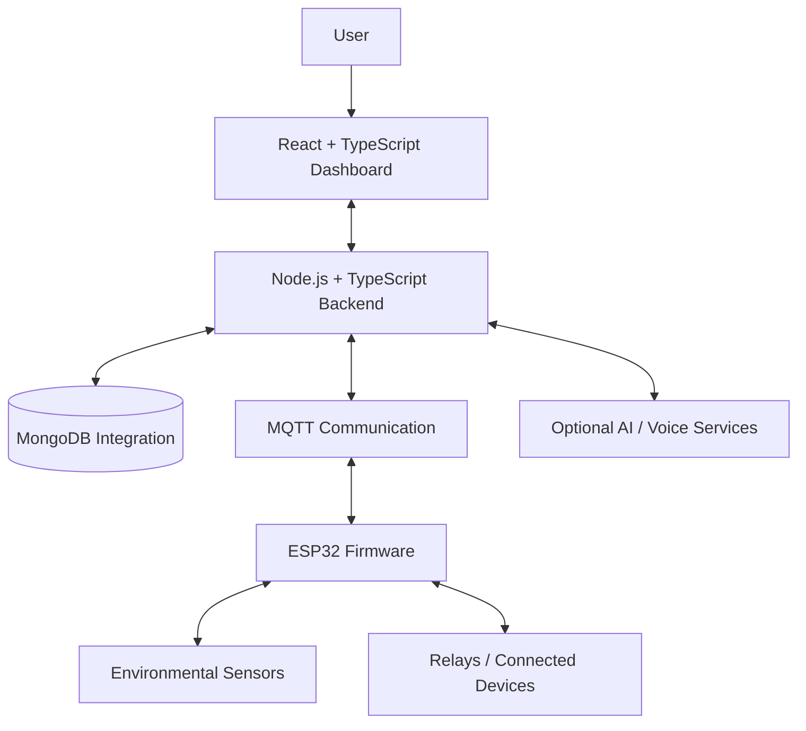

<div align="center">

# GrowPilot

###Smart IoT Crop Monitoring & Intelligent Automation

**Monitor growing conditions. Manage connected devices. Build smarter growing workflows.**

<p>
 
 
 
 
</p>

[Explore the Repository](https://github.com/alina01washim-aw/GrowPilot) · [Report a Bug](https://github.com/alina01washim-aw/GrowPilot/issues) · [Request a Feature](https://github.com/alina01washim-aw/GrowPilot/issues)

</div>

---

## What is GrowPilot?

GrowPilot is a smart agriculture and IoT project that brings crop-environment monitoring, connected-device controls, analytics, and automation tools into one web-based platform.

It is built around three parts: a dashboard for users, a backend for application and device logic, and ESP32-oriented firmware for hardware communication. The goal is to make growing-system information easier to understand and device management easier to organize.

> **Project status:** Under active development. The repository includes application modules and firmware, while individual features may still require configuration, hardware integration, and testing.

---

## Dashboard Preview

<div align="center">

<!-- Save the supplied dashboard screenshot as assets/growpilot-dashboard.png to display it here. -->


<sub>GrowPilot dashboard — sensor overview, alerts, environmental metrics, and device monitoring.</sub>

</div>

> **Add the screenshot:** Create an `assets` folder in the repository root, place your dashboard screenshot inside it, and name the image `growpilot-dashboard.png`. Keep this filename the same as the path above.

###Dashboard highlights

| Emergency alerts | Sensor overview | Analytics | Device control |
|---|---|---|---|
| View reported warnings and alert states | Review environmental readings and stale-data indicators | Explore historical data and growing metrics | Access controller and automation interfaces |

---

## Features

### Environmental Monitoring
- Dashboard cards for supported sensor readings.
- Interfaces for ambient temperature and humidity, CO₂, compost temperature, and derived VPD metrics.
- Historical views and charts for reviewing available readings.
- Visible stale-data indicators to help identify readings that may need attention.

### Alerts & Safety-Oriented Controls
- Emergency-alert interface with alert status and sound-control options.
- Emergency-stop functionality in the application and backend.
- Rule and threshold-related modules for monitoring and automation workflows.

**Safety note:** These interfaces do not by themselves guarantee safe operation. Test emergency-stop behavior, relay logic, and fail-safe behavior with the actual hardware before real-world use.

### Crop Cycle Management
- Crop-cycle and schedule interfaces.
- Crop-related monitoring and organization tools.
- A foundation for connecting environmental readings with growing workflows.

### Connected Device Management
- Controller and relay interfaces.
- Device history and status views.
- Firmware modules for Wi-Fi, MQTT communication, sensor handling, and relay control.

### AI & Voice Integration
- AI-assistant integration modules.
- Configurable AI and voice-service components.
- Supporting backend and frontend modules for related interactions.

Availability depends on local configuration, external service credentials, connected hardware, and implementation status.

---

## System Architecture



###How the parts fit together

1. **Dashboard:** Displays available readings, charts, alerts, settings, and control interfaces.
2. **Backend:** Provides application APIs and contains modules for device control, automation, data handling, and integrations.
3. **Database integration:** Supports persistence for application data where configured.
4. **MQTT and firmware:** Provide a communication path between backend services and the ESP32-oriented device firmware.
5. **Sensors and relays:** Supply measurements and enable hardware actions when compatible hardware and configuration are available.

---

## Tech Stack

<table>
 <tr>
 <td align="center" width="25%"><strong> Frontend</strong></td>
 <td>React · TypeScript · Vite · reusable UI components</td>
 </tr>
 <tr>
 <td align="center"><strong> Backend</strong></td>
 <td>Node.js · TypeScript · API routes · Zod validation</td>
 </tr>
 <tr>
 <td align="center"><strong> Data</strong></td>
 <td>MongoDB integration</td>
 </tr>
 <tr>
 <td align="center"><strong> Firmware</strong></td>
 <td>ESP32-oriented C/C++ · PlatformIO</td>
 </tr>
 <tr>
 <td align="center"><strong> Communication</strong></td>
 <td>Wi-Fi · MQTT</td>
 </tr>
 <tr>
 <td align="center"><strong> Integrations</strong></td>
 <td>Configurable AI and voice services</td>
 </tr>
</table>

---

## Repository Structure

```text
GrowPilot/
├── .github/
│ └── workflows/ # GitHub Actions workflows
├── assets/
│ └── growpilot-dashboard.png
├── client/ # React + TypeScript frontend
│ ├── public/
│ └── src/
│ ├── components/
│ ├── hooks/
│ ├── lib/
│ └── pages/
├── firmware/ # ESP32-oriented firmware
│ ├── include/
│ ├── src/
│ ├── platformio.ini
│ └── README.md
├── server/ # Node.js + TypeScript backend
│ └── src/
│ ├── lib/
│ ├── middleware/
│ ├── models/
│ └── routes/
├── .gitignore
├── WIRING.md
└── README.md
```

---

## Getting Started

###Prerequisites

- [Node.js](https://nodejs.org/) and npm
- [Git](https://git-scm.com/)
- [Visual Studio Code](https://code.visualstudio.com/) (recommended)
- [PlatformIO](https://platformio.org/) for firmware development
- MongoDB and MQTT services, if required by the selected backend features
- Compatible ESP32 board, sensors, and relay hardware for physical testing

###1. Clone the repository

```bash
git clone https://github.com/alina01washim-aw/GrowPilot.git
cd GrowPilot
```

###2. Run the frontend

```bash
cd client
npm install
npm run dev
```

Open the local URL printed by Vite in your terminal.

###3. Configure and run the backend

Open a separate terminal:

```bash
cd server
npm install
npm run
```

The final command lists the scripts defined by the project. Use the appropriate script shown there to start the backend.

Before running backend features, configure the necessary environment variables and service connections according to the code and configuration expected by the project.

###4. Build and flash firmware

1. Open the `firmware` directory in VS Code with PlatformIO installed.
2. Read `firmware/README.md` and `WIRING.md`.
3. Configure the correct board, Wi-Fi, MQTT, and device settings using safe local configuration.
4. Build the firmware.
5. Flash to compatible hardware and test with sensors and relays disconnected from hazardous loads first.

---

## Configuration & Security

GrowPilot may use API keys, service credentials, Wi-Fi passwords, MQTT credentials, and database connection strings.

- **Never commit secrets** to GitHub.
- Keep private configuration files excluded through `.gitignore`.
- Use local environment variables or a suitable secret manager for credentials.
- Commit only example configuration files with placeholder values.
- Review staged changes with `git status` before every commit.
- If a key is exposed, revoke it and create a replacement.

Some local configuration files are intentionally excluded from version control. Features that depend on them will need to be configured locally.

---

## Testing & Development

The repository includes selected test files for backend logic and client utilities. Run the scripts defined in each package's `package.json` to see which checks are available.

Recommended checks before a release:

- Run frontend and backend builds.
- Test API routes with valid and invalid inputs.
- Verify sensor readings and stale-data handling.
- Test MQTT connectivity and device reconnection.
- Validate automation thresholds and emergency-stop behavior.
- Confirm that secrets and local configuration files are not staged.
- Test hardware behavior in a controlled environment.

---

## Roadmap

- [ ] Document the complete local setup and environment variables.
- [ ] Validate the full sensor-to-dashboard data path on hardware.
- [ ] Add reproducible end-to-end testing for device control.
- [ ] Improve diagnostics for offline devices and stale readings.
- [ ] Expand crop-specific rules and automation scenarios.
- [ ] Document deployment and production monitoring.

---

## Contributing

Ideas, bug reports, and improvements are welcome.

1. Fork the repository.
2. Create a feature branch: `git checkout -b feature/your-feature`
3. Make and test your changes.
4. Commit your changes with a descriptive message.
5. Open a pull request explaining what changed.

For bugs or feature requests, use the [GitHub Issues page](https://github.com/alina01washim-aw/GrowPilot/issues).

---

## License

No license has been added yet. Until a license is included, the default copyright rules apply and reuse is not automatically permitted.

---

<div align="center">

### GrowPilot

**Connecting crop monitoring, IoT devices, and intelligent automation.**

[⭐ Star the repository](https://github.com/alina01washim-aw/GrowPilot) · [ Report an issue](https://github.com/alina01washim-aw/GrowPilot/issues)

</div>
